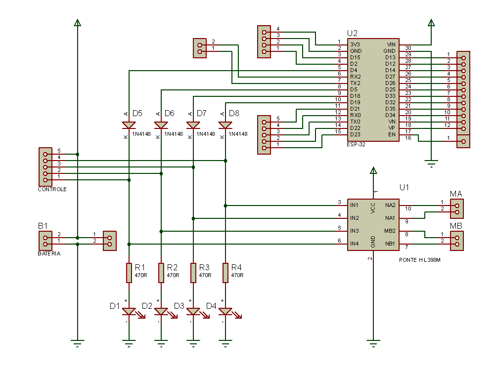

# Montagem e uso

## Esquema original

Esquema escolar do carrinho, fornecido pelo autor do projeto. O desenho identifica a ponte H como “L398M”; outros documentos a chamam de L298M ou mini L298N. Ele também inclui LEDs e diodos que não são controlados pelo firmware atual. A imagem é mantida como referência do projeto, sem tratá-la como um diagrama revisado de ligação.

## Ligações de controle

O esquema escolar e o sketch Bluetooth enviado para o projeto usam os seguintes pinos:

| Sinal da ponte H | GPIO do ESP32 |
|---|---:|
| IN1 | 19 |
| IN2 | 18 |
| IN3 | 5 |
| IN4 | 4 |

O sketch identifica o motor A como direito e o motor B como esquerdo. Essa convenção foi mantida no firmware publicado.

## Componentes registrados

A [lista de materiais](lista-de-materiais.md) reúne todos os itens dos documentos escolares. A bateria indicada é Ni-MH de 6 V e 2700 mAh.

Os documentos fornecem os sinais de controle, mas não descrevem por completo a distribuição de alimentação entre bateria, driver e ESP32. Por isso, esta página registra a pinagem e os componentes sem inventar uma ligação de alimentação.

## Controle por Wi-Fi

O firmware cria o ponto de acesso **Carrinho_ESP32** e hospeda uma página de controle.

1. Grave o firmware em uma placa ESP32 compatível.
2. Conecte o celular à rede Carrinho_ESP32.
3. Abra no navegador o endereço IP mostrado no Monitor Serial; o endereço padrão costuma ser 192.168.4.1.
4. Use os botões da página.

A senha inicial é **carrinho123**. Altere-a no sketch antes de usar.

## Controle por Bluetooth

O firmware anuncia o dispositivo **Carrinho_ESP32_RC** por Bluetooth Classic Serial (SPP). No aplicativo [Arduino Bluetooth Controller](https://play.google.com/store/apps/details?id=com.giristudio.hc05.bluetooth.arduino.control), configure os controles para enviar F, B, L, R e S.

## Comandos

| Comando | Ação no firmware |
|---|---|
| F | Aciona os motores para avançar |
| B | Aciona os motores para recuar |
| L | Aciona os motores em sentidos opostos para girar à esquerda |
| R | Aciona os motores em sentidos opostos para girar à direita |
| S | Coloca IN1, IN2, IN3 e IN4 em LOW |

Os comandos L e R foram corrigidos em relação ao sketch recebido: agora acionam os dois motores em sentidos opostos para realizar o giro no lugar.

## Estado do firmware

O mesmo sketch inicia Wi-Fi e Bluetooth. Se os dois meios enviarem comandos, o último comando processado controla os motores; não existe prioridade entre eles. A Espressif classifica a coexistência de SoftAP conectado e Bluetooth Classic conectado como suportada, mas com desempenho instável. O firmware não tem parada automática quando a conexão cai.

A compilação e a operação no carrinho físico ainda não foram verificadas nesta publicação.
